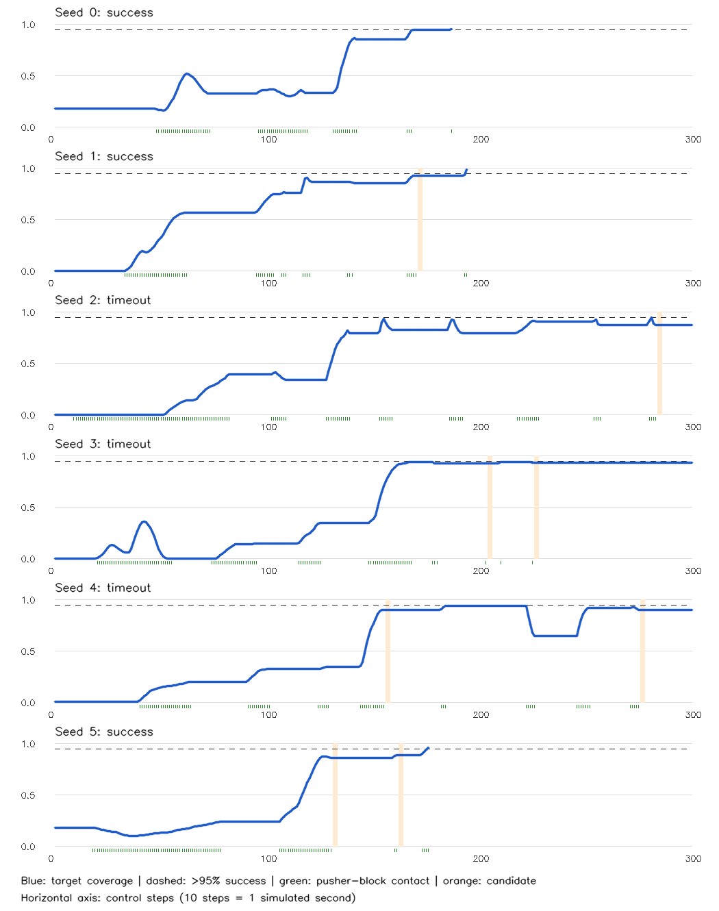
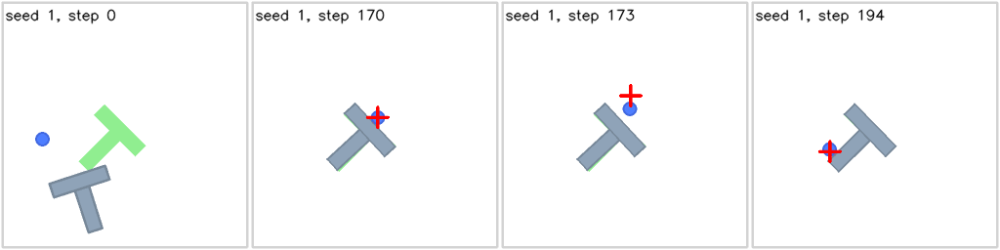

# PushT baseline: are contact failures a useful target?

Date: October 10, 2026

## Conclusion

**The unchanged baseline sometimes fails, but this screen does not establish missed contact as its main problem.** Three of six clean episodes succeeded; the other three timed out after coming close to the target. Eight contact-loss candidate windows occurred, including three windows in successful episodes. No contact-stall window met the prespecified rule.

The clearest observed issue is loss of good target alignment while executing cached actions. A contact-only interruption rule could miss that issue and could also interrupt normal repositioning. Keep the proposed interruption/adaptive-length method provisional; do not yet claim that it improves the baseline.

Fifteen oracle-selected local replanning trials produced **no measurable immediate alignment improvement** over continuing the cached actions. They cover only two or three remaining actions, so they do not settle whether earlier replanning can improve the rest of an episode.

The authoritative evidence is [summary.json](../results/robotics-baseline-check/summary.json), the frozen [protocol](../results/robotics-baseline-check/protocol.json), and the per-seed compressed traces and frame sheets in the same directory. Local replanning results and their interpretation are discussed below.

## Where the baseline comes from

The reused method is **Diffusion Policy**, introduced by Chi et al. [1]. We use Hugging Face's LeRobot v0.3.3 implementation and public `lerobot/diffusion_pusht` checkpoint, not the original authors' repository/checkpoint or an exact reproduction of the paper's reported benchmark scores [2, 3]. The environment is Gym-PushT 0.1.5 [4].

The frozen model takes 96 x 96 RGB images and the pusher's own position. It uses two observation frames, a prediction horizon of 16, and eight executed actions per new prediction. The checkpoint uses DDPM with 100 denoising steps and FP32. Images are collected every control step, but new predictions occur only when the eight-action queue empties [2].

Each action is a two-dimensional pusher target position and advances 0.1 simulated seconds. The simulator already has low-level position feedback. "Cached execution" describes the high-level AI action sequence, not an absence of all physical feedback.

Our contribution in this step is **diagnostic instrumentation and a bounded investigation**, not a new robot policy or an implemented adaptive controller.

## What was checked

Six episodes used seeds 0-5, the original eight-action setting, and the existing 300-step limit, without injected disturbances. Seeds 0-2 repeat the feasibility screen; seeds 3-5 add new initial conditions and diffusion randomness. These are exploratory runs, not a held-out controller evaluation or a reliable success-rate estimate.

Logging records the commands, prediction boundaries, pusher/block motion, target coverage, and actual pusher-block contact. Simulator geometry and contact information are used **only for diagnosis**. They are not provided to the frozen policy or presented as an already-implemented vision-only monitor.

### Important contact-field correction

The environment's generic contact counter can include wall collisions. Its published `info["n_contacts"]` is also coarsely normalized, so it is not a reliable quantitative pusher-block contact count. The recorder preserves the original collision callback and separately counts contact points only when the two bodies are the pusher and the block. These are accumulated collision-callback points, not force measurements or distinct contact events.

Two identical-action simulator runs matched for 100 control steps with and without this recorder. Positions, velocities, geometry, and camera hashes are checked exactly; coverage allows a 1e-12 absolute tolerance because geometric-area calculations can differ in their final floating-point bit. The repeated AI episodes also matched their saved outcomes, step counts, prediction counts, and rewards within that tolerance. One maximum-reward difference was 1.11e-16; the six episodes were retained, not repeated or modified.

### Prespecified candidate rules

The screen examines three consecutive actions inside one chunk, with at least two cached actions still pending. It requires mean target-command distance of at least five simulator pixels and at most two pixels of block-vertex displacement over the window. Vertex displacement includes rotation as well as translation.

- **Contact-loss candidate:** actual contact occurred earlier in the same chunk, followed by three no-contact actions near the block (surface gap no more than ten pixels).
- **Contact-stall candidate:** actual contact persists throughout the window, but the commanded motion produces little block movement.

These thresholds are exploratory diagnostic rules, not tuned controller parameters. A flag is **not a failure label**: approach, retreat, repositioning, and precision corrections can legitimately include no contact or little block movement. The screen can also miss other forms of ineffective pushing.

## Baseline results

Success requires target coverage strictly greater than 95%. Coverage measures how much of the target region is occupied by the block [4].

| Seed | Outcome | Steps | Best coverage | Final coverage | AI predictions | Contact-loss candidates |
|---|---|---:|---:|---:|---:|---:|
| 0 | Success | 187 | 95.85% | 95.85% | 24 | 0 |
| 1 | Success | 194 | 99.23% | 99.23% | 25 | 1 |
| 2 | Timeout | 300 | 94.88% | 87.57% | 38 | 1 |
| 3 | Timeout | 300 | 94.62% | 93.64% | 38 | 2 |
| 4 | Timeout | 300 | 94.65% | 90.43% | 38 | 2 |
| 5 | Success | 176 | 96.02% | 96.02% | 22 | 2 |

The six episodes executed 1,457 actions with 185 AI predictions. Logged episode wall times were 1.81-3.13 minutes, supporting the earlier laptop-feasibility conclusion. Those times exclude model loading and post-episode video encoding and are not a controlled speed benchmark.



### A candidate that is not a demonstrated failure

Seed 1 lost contact during steps 171-173 while coverage stayed near 92.94%. The recorded images show the pusher moving away from the block. It later regains contact at step 193 and succeeds at step 194. This is consistent with repositioning, not evidence that the intervening actions should have been interrupted.



The red cross is the commanded pusher position; the blue circle is the pusher; the gray T is the block; the green region is the target.

### A confirmed task failure with regression during contact

Seed 2 illustrates the limitation of a contact-only trigger:

| Step | New prediction? | Pusher-block contact points | Coverage |
|---|---|---:|---:|
| 281 | Yes | 10 | 94.88% |
| 282 | No; cached action | 10 | 88.89% |
| 283 | No; cached action | 5 | 87.57% |
| 284-286 | No; cached actions | 0 | 87.57% |

Alignment deteriorates **while contact is maintained**, before the contact-loss candidate ends at step 286. Interrupting at that later flag could attempt recovery, but cannot prevent the earlier regression. The episode ultimately times out at step 300.

This is a verified observation of harmful local alignment change, not proof of its complete cause or proof that a fresh prediction would fix it. Temporary alignment decreases can also be useful during rotation, so a progress-based trigger would need appropriate context.

## Local earlier-replanning probes

The first flagged window in each eligible seed is selected chronologically, not by which restart performs best. The probe compares the remaining cached actions in that chunk with one fresh prediction from the **same physical state**. The environment is reconstructed by replaying the saved action prefix; positions, velocities, geometry, and camera hash must match. The pending action plan is cleared and the two-frame observation history is restored before requesting a new prediction.

Each probe retains all three prespecified fresh-prediction seeds (1000, 1001, 1002). The unchanged branch uses its recorded cached actions; each restart adds exactly one AI call. This is an oracle-selected diagnostic because the selection uses simulator information and offline inspection. It is **not** a deployable monitor, a full-episode recovery test, or a fair evaluation of an adaptive controller.

| Seed | Interrupt after step | Remaining actions compared | Baseline end coverage | Fresh-prediction end coverage, all three trials |
|---|---:|---:|---:|---:|
| 1 | 173 | 3 | 92.94% | 92.94% |
| 2 | 286 | 2 | 87.57% | 87.57% |
| 3 | 206 | 2 | 93.11% | 93.11% |
| 4 | 158 | 2 | 90.53% | 90.53% |
| 5 | 133 | 3 | 86.16% | 86.16% |

At the end of all 15 trials, the block geometry matched the respective branch state; coverage differences from cached continuation were at most 2.22e-16. No trial reached the target during this interval. Each added one AI query and took about 4.76-5.14 seconds for inference and the local rollout. The results are recorded under `local_probes` in [summary.json](../results/robotics-baseline-check/summary.json); no best-of-three restart was selected.

This supplies **no positive evidence of immediate recovery at these contact-loss flags**. It also does not prove replanning is useless: a fresh plan may first reposition the pusher and only improve alignment after more actions. The probe deliberately stops before evaluating that longer-term possibility. It cannot establish episode-success improvement or the combined adaptive-length method's value.

## Recommendation

**Continue investigating execution timing, but do not implement a contact-only controller as though its value were established.** The proposed two-layer structure remains plausible: interrupt harmful execution and adapt how many actions are committed between predictions. The unresolved part is identifying harmful execution reliably and demonstrating that fresh predictions help.

The next bounded comparison should test reasonably chosen fixed execution lengths, including the original eight and a shorter setting, before adding both proposed layers. A useful method should offer a better task-success/computation trade-off than simply predicting more frequently. Preserve the model, task, episode limit, and separation between tuning and later evaluation.

A progress-aware or near-target trigger is a possible refinement suggested by these observations, **not an established project decision or claimed improvement**. Discuss its formulation first. Any future visual monitor must be evaluated against the simulator diagnostics, including legitimate repositioning cases, without silently using privileged state.

## Reproduction

Use the existing `.venv-robotics` environment and pinned model from the [feasibility report](2026-10-10-robotics-laptop-feasibility.md). No policy training, paid API, new simulator, or additional dependency is required.

Save a fresh screen separately so the authoritative evidence is not overwritten:

```powershell
.\.venv-robotics\Scripts\python.exe experiments\robotics_baseline_check.py --output-dir results\robotics-baseline-check-repeat --video-dir tmp\robotics-baseline-videos-repeat
.\.venv-robotics\Scripts\python.exe experiments\robotics_baseline_check.py --review-only --output-dir results\robotics-baseline-check-repeat
.\.venv-robotics\Scripts\python.exe -m unittest discover -s tests -p test_robotics_baseline_check.py -v
```

The script refuses a nonempty output directory for a new screen. `--probes-only` resumes the probes from completed baseline recordings after validating the saved model configuration and feasibility checks; it replaces only the derived probe summary. The full videos are local scratch evidence under `tmp/`; shareable traces, summaries and selected lossless frames are retained in `results/`.

All 12 CPU unit tests passed, covering candidate-rule guards, rotation-aware motion, passive recording, action-prefix replay, and numeric comparison limits. These checks validate the diagnostic tooling, not the proposed controller's effectiveness.

## References

1. Chi et al. **Diffusion Policy: Visuomotor Policy Learning via Action Diffusion**, RSS 2023; extended version available on [arXiv](https://arxiv.org/abs/2303.04137). [Authors' project page](https://diffusion-policy.cs.columbia.edu/).
2. Hugging Face. [LeRobot v0.3.3 Diffusion Policy implementation](https://github.com/huggingface/lerobot/blob/v0.3.3/src/lerobot/policies/diffusion/modeling_diffusion.py), especially `select_action`, `generate_actions`, and observation/action queues. [Official pretrained-policy evaluation example](https://github.com/huggingface/lerobot/blob/v0.3.3/examples/2_evaluate_pretrained_policy.py).
3. Hugging Face. [Public Diffusion Policy PushT checkpoint](https://huggingface.co/lerobot/diffusion_pusht), pinned revision `84a7c23178445c6bbf7e1a884ff497017910f653`; verified weight SHA-256 and configuration recorded in the protocol. This checkpoint's authorship must not be conflated with the original paper's released weights.
4. Hugging Face. [Gym-PushT official simulator repository](https://github.com/huggingface/gym-pusht). Installed version 0.1.5; contact handling, physical stepping and success criterion were checked against that installed source.
