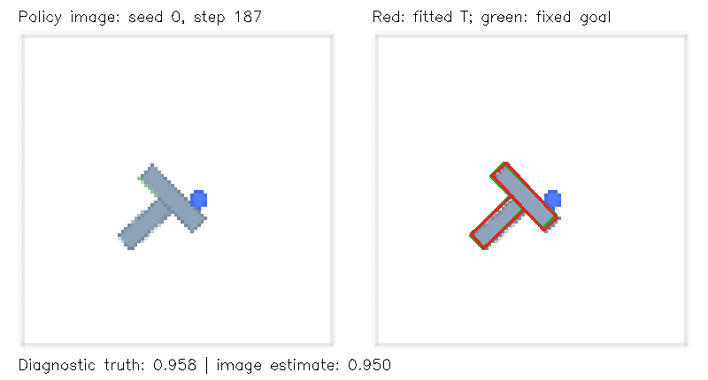

# Does a small learned controller know when replanning helps?

Date: October 11, 2026

## Conclusion

**The prototype runs correctly and showed a small observed benefit, not a convincing general improvement. It finished 16/20 new cases versus 15/20 for the original baseline. Mean AI calls were almost unchanged, and monitoring made mean execution slightly slower: 126.69 versus 121.87 seconds.**

This pilot tests our proposed **benefit-aware replanning gate** around the unchanged pretrained Diffusion Policy. Rather than treating every alignment decrease as failure, a small decision tree learns whether interrupting is more useful than continuing. This is our adaptation of established ideas, not a claim that learned replanning is new. All eight held-out interruptions addressed **stagnation**, with zero alignment-decrease warnings at those points.

The frozen budget is complete: **17 discovery checkpoints, 102 matched continuations, and 80 held-out complete attempts**. The checkpoints are split into 12 training and five validation episodes. Existing baseline recordings remain unchanged. All 91 unit tests passed; an independent audit checked every continuation and held-out attempt without finding a mismatch.

**Recommendation:** retain the robotics question, but do not expand the model or implement adaptive future movement lengths yet. First inspect the saved interruption cases and discuss a simpler controller using the same candidate timing. The present results do not isolate the value of learning, and they do not establish a reliable warning-based recovery method.

## Motivation and system

Our [previous investigation](2026-10-11-robotics-failure-patterns.md) found 20 successful baseline attempts and 10 timeouts. A one-shot replan helped some selected failures but also harmed a successful control: overall, both options succeeded in 5/12 continuations. Therefore, detecting suspicious movement does not establish that replanning will help.

The CPS loop is: camera image of the physical simulator → estimate object alignment → decide whether to retain the action queue → execute a pusher movement → receive another camera image. The physical task is to push and rotate the T-shaped block onto its target. The existing robot policy already uses visual feedback when it predicts again; our addition changes when that prediction happens.

The reused simulator tracks pusher and block positions and velocities, plus block orientation and angular velocity. Policy actions are two-dimensional pusher target positions, not direct block movements; contact physics determines how the block moves. The base policy observes camera pixels and pusher position, while our additional monitor uses pixels and pending-action count. Physics advances when a command is executed, not during GPU prediction: this is offline simulated control, not a real-time robot deployment.

We retain the pinned public Diffusion Policy checkpoint, PushT environment, two observation frames, 16-step prediction horizon, 100 DDPM denoising steps and FP32 inference. The usual queue executes eight actions per prediction. Success requires target coverage **strictly greater than 95%**, within **300 total actions**. No disturbances are injected in this first pilot. Setup details and checkpoint provenance are in the [feasibility report](2026-10-10-robotics-laptop-feasibility.md).

## Camera-derived signals

The runtime monitor receives the policy's 96 × 96 RGB image and the number of pending actions. It segments the renderer's block color, fits the known rigid T silhouette, and estimates alignment against the known static target. These shape and target specifications are task knowledge, not dynamic simulator state. An unreliable fit causes abstention and clears the recent feature history.

Let \(\hat c_t\) be camera-estimated target coverage. Our eight inputs are current coverage, warning count, drawdown, recent recovery, recent best-coverage gain, position error, orientation error and pending-action count.

- **Warning count:** number of decreases larger than 1.5 percentage points among the latest five changes.
- **Drawdown:** highest estimated coverage among the latest eight observations minus current coverage. Unlike adding every decrease forever, it does not retain old deterioration after recovery.
- **Recovery:** total estimated coverage change across the latest three changes.
- **Recent best gain:** best estimated coverage in the latest 25 observations minus the first observation in that window. This feature is named `stagnation` in the code; a small value means little progress, not a confirmed failure.

Position error is image-plane distance to the target divided by image width (96 pixels); orientation error is the wrapped angular error divided by \(\pi\). Both are current estimated errors, not predicted future motion.

Eligibility is fixed before collecting outcome labels. Between actions 32 and 284, with at least two pending actions, the first of either condition qualifies:

1. **Confirmed regression:** at least two warnings, drawdown of at least three percentage points, and an eight-observation recent peak of at least 80%.
2. **Stagnation:** a complete 24-action window, at least 75% coverage at both endpoints, and at most one percentage point of best-coverage gain.

These are candidate rules, not failure labels. They use only information already observed. The rules exclude the current terminal observation.

### Completed input checks

CPU-only action replay reproduced every saved camera hash without new AI inference. All valid frames had usable estimates; no invalid frames occurred in the checked collection. Errors below are **percentage points of target coverage**, not relative percentages.

| Check | Frames / successive pairs | Mean absolute coverage error | 95th-percentile coverage error | 95th-percentile coverage-change error |
|---|---:|---:|---:|---:|
| All 30 recorded attempts | 5,986 frames | 0.505 points | 1.920 points | 0.738 points |
| Near-target subset | 1,951 frames / 1,911 pairs | 0.865 points | 2.431 points | 1.126 points |

The global visual gate and the additional near-target check passed. Maximum single-frame error is 4.844 points and maximum change error is 4.498 points, so individual warnings can still be inaccurate. Mean measured monitoring cost was 48.32 ms per frame. These checks establish input usability in this fixed renderer, not warning reliability or real-camera robustness. Evidence: [global validation](../results/robotics-benefit-pilot/visual-validation.json) and [near-target validation](../results/robotics-benefit-pilot/near-target-validation.json).



Example from a saved attempt: the red outline estimates the block from the camera image; the green outline is the fixed target. The simulator coverage in the caption is diagnostic truth, not a controller input.

A separate two-prediction GPU smoke check confirmed that fixed-four retains the **first four actions** of the corresponding fixed-eight prediction under the same random seed, and that those four actions produce matching physical states. Both configuration and action-queue capacity are changed together. This verifies the comparison's implementation, not its task performance. The robotics test suite passed **91 tests** before collection.

## Matched outcomes and the small model

Discovery uses existing episodes 0–29. Select the first camera-derived eligible checkpoint per episode in ascending seed order, up to a cap of 20. Seventeen qualify. Selection does not use whether the original attempt succeeds, whether interruption wins, or future alignment. Every third selected episode is assigned to validation, yielding 12 training and five validation episodes; all repeats of a situation stay in the same split.

At each checkpoint, replay the recorded prefix and restore the two-frame observation history. Compare:

| Arm | Initial choice | Later behavior |
|---|---|---|
| Continue | Execute the pending original actions | Fixed-eight predictions thereafter |
| Replan | Discard the pending actions and request a fresh prediction | Fixed-eight predictions thereafter |

Each arm uses all three fresh diffusion seeds, 3000–3002. Thus, \(17\times3\times2=102\) continuations. Both arms retain the original **300-action total limit**, including the prefix; they do not receive 300 additional actions. Continued cached actions must reproduce their recorded physical states until the first fresh prediction. The old recorded suffix is a reference, not the comparison arm.

Let \(S_{ir}^{\mathrm{replan}}\) and \(S_{ir}^{\mathrm{continue}}\) indicate whether each continuation finishes successfully. The training target is

\[
\hat b_i=\frac{1}{3}\sum_{r=1}^{3}
\left(S_{ir}^{\mathrm{replan}}-S_{ir}^{\mathrm{continue}}\right).
\]

Positive values favor interruption; negative values favor keeping the queue. This is a noisy **empirical success difference**, not a calibrated probability or a label saying that the original movement was wrong.

The tree learns success benefit, **not computation benefit**. AI calls only break validation-threshold ties. A situation where both options succeed but replanning saves many calls still has a zero training target; the positive-benefit rule can therefore miss cost-saving opportunities. Monitoring cost is measured during held-out evaluation, not included in this training target.

A deterministic, NumPy-only CART-style regression tree fits these targets by greedily reducing

\[
\mathcal L(f)=\sum_{i\in\text{training}}\left(\hat b_i-f(x_i)\right)^2.
\]

Each leaf predicts the mean training benefit of its assigned checkpoints. Maximum depth is two, with at least three checkpoints in each child leaf. This is greedy fitting, not a guarantee of the globally optimal tree. The expensive Diffusion Policy is neither retrained nor queried to check every action.

For feature vector \(x_t\), the learned gate interrupts if

\[
f(x_t)>\max(\tau,0.05).
\]

Choose \(\tau\) from \(\{0,0.1,0.34,0.67,1.1\}\) using validation outcomes only: prefer higher success, then fewer AI calls, then the higher threshold. The 1.1 candidate always continues and provides a conservative fallback. Freeze the selected model and threshold before examining held-out results.

At runtime, the learned gate makes **one decision at the first eligible point**. If it chooses to continue, it does not revisit that decision later. If it interrupts, it clears only pending actions and preserves observation history. Both choices return to fixed-eight behavior for the remainder of the attempt. Repeated decisions and adaptive future queue lengths are outside this pilot.

### Completed training and validation

The frozen tree selected only two of the eight available features. At an eligible point, it requests a new plan when current camera-estimated coverage exceeds **84.6595%** and recent best-coverage gain is at most **0.6581 percentage points**; otherwise, it keeps the queue. This means "close to the target, but making little progress," not "every decrease is a failure." Warning count and drawdown still help select candidate points, but the fitted tree did not use them as split variables.

The validation-selected threshold is **0.1**. The gate intervened at one of five validation checkpoints. It achieved the same mean success as continuing, **5/15 repeated continuations**, and reduced mean remaining AI calls only from **15.33 to 15.07**. Therefore, the selected threshold won on the call-cost tie-break, not improved validation success. Three repeats of each situation do not make 15 independent situations.

The completed label bank also allows a descriptive comparison without new inference. Each table entry shows **successes / continuations; mean remaining AI calls**:

| Selected checkpoints | Always continue | Always replan | Frozen learned gate |
|---|---:|---:|---:|
| Training: 12 situations | 21/36; 12.83 | 21/36; 11.64 | 25/36; 12.39 |
| Validation: five situations | 5/15; 15.33 | 10/15; 11.20 | 5/15; 15.07 |

Here, "always replan" selects the already-recorded replan arm at each checkpoint and then returns to fixed-eight. It is **not** an additional full held-out controller experiment. The gate's training advantage did not carry over to validation, and its validation result was worse than this simple recorded-arm choice. Since validation selected the threshold, neither row is independent test evidence.

Across the 17 situations, replanning had positive empirical benefit at six, negative benefit at three and zero benefit at eight. Strong signals were not sufficient: at seed 16, action 132, two warnings and a 17.05-point drawdown preceded 2/3 successes by continuing versus 1/3 by replanning. Stagnation was not sufficient either: at seed 0, action 164, continuing succeeded 3/3 versus 1/3 by replanning. These examples reinforce why a suspicious observation is not automatically a useful interruption point.

The saved [model and validation candidates](../results/robotics-benefit-pilot/model.json) expose the complete tree and selection results. An independent read-only audit recomputed all 17 paired targets, the tree and every threshold candidate. It also checked all 102 trial identities, trace hashes, branch states and query counts, including 258 cached actions and their reproduced states. These checks establish correct experiment execution, not controller effectiveness.

## Held-out comparisons and measurements

Evaluate unused episode seeds 30–49, one stochastic sample per method: \(20\times4=80\) complete attempts. Each method starts from the same initial scene and resets the random generators to the episode seed. Noise is aligned by prediction order, not by physical time; different methods subsequently observe different scenes. Rotate method order across episodes to reduce order-related timing bias.

| Method | Behavior |
|---|---|
| Fixed-eight | Original execution interval |
| Fixed-four | Predict again after four actions; a preselected shorter baseline, **not** the best tuned interval |
| Warning rule | Interrupt at the first confirmed regression, then fixed-eight; an earlier stagnation does not consume its opportunity |
| Learned gate | Decide once at the first regression-or-stagnation candidate, then fixed-eight |

The warning baseline is deliberately stronger than a rule forced to decide at an earlier non-warning stagnation point. Its decision opportunity differs from the learned gate's, which must be considered when interpreting outcomes.

Report success count/rate, mean final alignment, mean total AI calls, and mean execution runtime. Also report monitoring time, eligible decisions, interruptions and paired success outcomes. Runtime includes initial monitoring and subsequent decision computation, but excludes model loading and environment setup. Monitoring stops once its one decision is made. Simulator geometry and coverage are stored for diagnostics and final scoring only; they are not controller inputs.

### Completed held-out results

All entries below average **20 previously unused starting scenes**, seeds 30–49. Alignment is final target coverage, not intersection-over-union. Runtime includes monitoring where applicable.

| Method | Successful pushes | Mean final alignment | Mean AI calls | Mean execution time |
|---|---:|---:|---:|---:|
| Original fixed-eight | 15/20 (75%) | 92.04% | 24.65 | 121.87 s |
| More frequent fixed-four | 5/20 (25%) | 87.73% | 65.85 | 323.91 s |
| Warning rule | 15/20 (75%) | 93.59% | 25.60 | 132.73 s |
| Our learned gate | 16/20 (80%) | 94.56% | 24.40 | 126.69 s |

The learned gate retained all 15 baseline successes and recovered **one additional case, seed 31**. That is a five-percentage-point observed success difference and a 2.52-point improvement in mean final coverage. However, it saved only **five AI calls across all 20 attempts** (0.25 per attempt, about 1%) and took **4.82 seconds longer per attempt** (about 4%). This is not a runtime improvement.

Fixed-four is clearly unattractive in this pilot: it made many more predictions and completed fewer tasks. This does not prove eight is optimal or that frequent feedback is generally harmful; four was one preselected interval, and the frozen policy's behavior changes when fewer cached actions are executed.

The warning rule recovered seed 44 but lost the baseline success at seed 30, leaving its total unchanged. Compared with that rule, the learned gate succeeded additionally at seeds 30 and 31, but failed at seed 44. Therefore, the methods are not interchangeable, even though their aggregate success counts differ by only one.

Evidence: [complete summary](../results/robotics-benefit-pilot/summary.json), [all evaluation sidecars](../results/robotics-benefit-pilot/evaluation.json), and per-attempt compressed action/state traces in `evaluation/`.

### What the eight interruptions actually did

The gate made a decision in 13/20 attempts and interrupted in eight. Five eligible decisions kept the queue; seven attempts had no eligible decision. Every interruption in this pilot was triggered at a stagnation candidate with **zero warnings**, not at a regression candidate.

| Seed | After action | Original baseline → learned gate | AI calls: baseline → gate |
|---|---:|---|---:|
| 31 | 145 | Failure → success | 38 → 37 |
| 36 | 161 | Success → success | 25 → 24 |
| 37 | 149 | Success → success | 21 → 27 |
| 41 | 114 | Success → success | 29 → 17 |
| 43 | 146 | Success → success | 19 → 20 |
| 44 | 153 | Failure → failure | 38 → 39 |
| 47 | 145 | Failure → failure | 38 → 39 |
| 48 | 157 | Success → success | 21 → 21 |

For an exact example, **seed 31** reaches the decision after action **145**. The original baseline would keep its cached actions **146–152**, then predict again before action 153. Our gate discards those seven pending actions and requests an updated plan **before action 146**. It later reaches the benchmark target; the baseline times out. Action 145 is our detected candidate, not a proven moment when failure began. These are full held-out attempts, not the selected matched-continuation training cases.

Call savings were not consistent: seed 41 saved 12 calls, while the other seven interventions together added seven calls. The observed net saving was therefore concentrated in one situation. Mean monitoring took **6.15 seconds per learned-gate attempt** and **6.90 seconds per warning-rule attempt**; no-intervention attempts can still incur monitoring cost.

Seed 44 illustrates sensitivity to timing. The gate interrupted at stagnation after action 153 and failed. The warning rule waited until regression after action 157 and succeeded with 27 calls. This single sample suggests that a suspicious state and a useful replanning moment can differ by a few actions; it does not prove a universally better pause point.

### What this establishes—and what it does not

The laptop can run the complete offline pipeline, the camera-derived loop is implemented, and the method can help individual cases. The observed overall gain is **small**. One extra success and one stochastic sample per scene do not justify a claim of a statistically established or robust improvement. The validation gate also showed no success advantage.

An independent audit confirmed all 80 initial scenes, 6,432 shared-prefix actions/states and 25 complete non-interrupted adaptive trajectories matching fixed-eight. Source, visual-data, package and checkpoint identities were unchanged. Summary metrics and all paired outcomes were independently recomputed. These checks validate execution, not generalization.

Important limits remain:

- Only 12 independent training situations and five validation situations support the fitted tree; the three repeats are not additional independent situations.
- The learned gate stops monitoring after its first decision, even when it keeps the queue. It can miss a later, more informative opportunity.
- The warning rule uses a different decision opportunity. We did **not** run a held-out always-replan-at-first-candidate or simple stagnation-only comparator, so learning's added value is not isolated.
- Fixed-four is not a tuned best fixed interval. Repeated interruptions, future queue-length adaptation, disturbances and additional policy-noise samples were not evaluated.
- Camera fitting relies on this clean renderer and known geometry. Its measured accuracy does not establish warning reliability, real-camera robustness or causal explanations of each failure.
- Execution-time comparisons are descriptive measurements on one laptop, not controlled deployment latency or real-time feasibility.

The appropriate next discussion is about **better interruption evidence and fair same-timing baselines**, not immediately a larger model. The existing traces should guide that discussion; no extra experiments were added or parameters retuned after observing these held-out results.

### Laptop resource cost

Matched-label collection took **1.75 hours** including prefix replay and setup. Summing the 80 recorded execution timings gives **3.92 hours**; that excludes model loading, pauses and trace writing, so it is not the total elapsed wall-clock duration. This confirms offline feasibility, but experiments require hours rather than interactive execution.

Peak measured PyTorch GPU allocation was **1.07 GiB**, with **1.15 GiB** reserved. The resumed evaluation's peak process memory was **2.57 GiB**. The original process stopped after 35 saved attempts; with no process still running, evaluation resumed and verified those results before running only the remaining 45. Thus, the [evaluation resource file](../results/robotics-benefit-pilot/evaluate-resources.json) covers that resumed invocation, not all 80 attempts. Earlier label and training resource files were preserved.

## Reproduction and evidence preservation

Use `.venv-robotics` and the existing pinned checkpoint. No new training dependency or paid API is needed. The saved [protocol](../results/robotics-benefit-pilot/protocol.json) records source/code/configuration hashes, feature rules, checkpoints, splits and seeds. Resume checks reject changed evidence; the frozen model is bound to protocol and label hashes. Completed traces are checked against sidecars before reuse. The original six recordings and 30-attempt collection are not overwritten or rerun.

```powershell
.\.venv-robotics\Scripts\python.exe experiments\robotics_benefit_pilot.py --stage run
.\.venv-robotics\Scripts\python.exe -m unittest discover -s tests -p 'test_robotics_*.py' -v
```

`run` resumes the frozen pilot through preparation, labels, training, evaluation and summary; it skips matching saved continuations and episodes. Do not run a second GPU collector concurrently. CPU visual replay is a separate prerequisite and refuses to overwrite its saved outputs. GPU allocation, process memory and stage duration are recorded separately; a resumed invocation's stage duration is not the original full collection duration.

To reproduce the pilot without overwriting authoritative results, use a new, Git-ignored repeat directory. The first two commands prepare the camera checks; the third collects labels, trains the small tree and evaluates it. This reuses the saved discovery attempts and the same evaluation seeds, so it is a reproduction, not an additional independent evaluation.

```powershell
.\.venv-robotics\Scripts\python.exe experiments\robotics_visual_monitor.py --output results\robotics-benefit-pilot-repeat
.\.venv-robotics\Scripts\python.exe experiments\robotics_visual_monitor.py --near-target --output results\robotics-benefit-pilot-repeat
.\.venv-robotics\Scripts\python.exe experiments\robotics_benefit_pilot.py --stage run --output-dir results\robotics-benefit-pilot-repeat
```

For an interrupted evaluation with completed labels and training, resume `--stage evaluate` and then run `--stage summarize`; this preserves earlier stage timing files. Keep the installed environment unchanged: package versions are recorded in the protocol, but the runner does not automatically compare them during resume. An independent audit confirmed matching installed versions for this run.

The robotics branch's `.gitattributes` preserves the recorded source and JSON line endings on Git checkout so byte-level hashes remain meaningful. A fresh checkout with automatic line-ending conversion disabled matched all 50 frozen fingerprints/bindings and all 182 trial-trace hashes. Do not normalize the frozen files manually.

## Related work and attribution

Our [expanded literature review](2026-10-11-robotics-replanning-literature.md) distinguishes published methods, preprints, code access and hardware requirements. The present gate is inspired by those ideas, not a faithful reproduction of their algorithms or results:

- **Diffusion Policy** supplies the frozen movement predictor and visual-feedback baseline: [Chi et al., RSS 2023](https://arxiv.org/abs/2303.04137).
- **Gym-PushT** supplies the reused rigid-body simulator and camera renderer: [Hugging Face implementation](https://github.com/huggingface/gym-pusht). The local package version is pinned in `requirements-robotics.txt` and recorded in the pilot protocol.
- **SGAC** motivates keeping useful cached actions and adapting execution, but its fresh-prediction consistency checks differ from our cheap camera features and outcome-trained gate: [So et al., 2025](https://arxiv.org/html/2510.12392v1).
- **React When You Need To** supplies precedent for learned observation-driven triggers and warning confirmation; we do not reproduce its asynchronous VLA execution: [Wu et al., 2026 preprint](https://arxiv.org/html/2609.22587v1).
- **DEHP** supplies precedent for a small learned execution controller around frozen Diffusion Policy; our supervised paired-outcome tree differs from its online reinforcement-learned horizon head: [Zhao et al., 2026 preprint](https://arxiv.org/html/2606.11408v2).

Our implemented course contribution is this narrowly specified adaptation and its reproducible critical evaluation. A strong performance improvement, publication-level novelty, reliable real-world perception and real-time robot deployment are not established.
